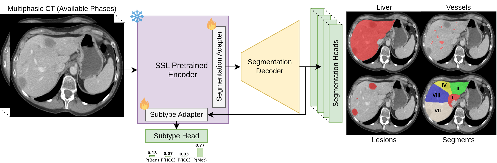

<h1 align="center">Comprehensive Liver Segmentation</h1>

<p align="center">
  <b>Muhammad Alberb, Daniela Carrascal-Penaranda, Nicole Erazo-Morera, Michael J. Raphael, Paul J. Karanicolas, Helen Cheung, Anne L. Martel</b>
</p>

<p align="center">
  <a href="https://spie.org/medical-imaging/presentation/Comprehensive-liver-segmentation-and-lesion-subtype-classification-in-multiphasic-CT/14518-51">Paper</a> ·
  <a href="#installation">Installation</a> ·
  <a href="#inference">Inference</a> ·
  <a href="#citation">Citation</a> ·
  
</p>

Official inference code for **"Comprehensive liver segmentation and lesion subtype classification in multiphasic CT"**, to be presented at SPIE Medical Imaging 2027 (Vancouver, 14–18 February 2027).

## Overview
<p align="center"></p>

Given a CT volume, the model jointly predicts four structures:

- the liver,
- liver lesions,
- hepatic vessels, and
- the eight Couinaud segments.

The model is a [3DINO](https://github.com/AICONSlab/3DINO) ViT-L backbone fine-tuned with LoRA, combined with a UNETR decoder. Inference uses sliding-window prediction with 160 × 160 × 160 mm patches.

This repository contains the LoRA and decoder weights (`checkpoints/liver_seg_head.pth`). The pretrained 3DINO backbone must be downloaded separately (see [Pretrained weights](#pretrained-weights)).

## Installation

Python 3.9 or newer is required. The code was tested with Python 3.13.

```bash
conda create -n liverseg python=3.13 -y
conda activate liverseg
pip install -r requirements.txt
```


## Pretrained weights

| Weights | Source | Location |
|---|---|---|
| Fine-tuned LoRA + decoder | included in this repository | `checkpoints/liver_seg_model.pth` |
| 3DINO ViT backbone | [AICONSlab/3DINO-ViT](https://huggingface.co/AICONSlab/3DINO-ViT) | `checkpoints/3dino_vit_weights.pth` |

The 3DINO repository on Hugging Face is gated. Log in, accept the access conditions on the model page, and then download `3dino_vit_weights.pth` from the **Files** tab into `checkpoints/`.

## Inference

```bash
python uni_predict.py path/to/images path/to/output
```

Every `.nii` / `.nii.gz` file in the input folder is segmented. Inputs must be CT volumes in Hounsfield units.

### Outputs

Results for `scan.nii.gz` are written to `path/to/output/scan/`.

| File | Structure | Labels |
|---|---|---|
| `liver.nii.gz` | Liver | binary |
| `liver_lesions.nii.gz` | Liver lesions | binary |
| `liver_vessels.nii.gz` | Hepatic vessels | binary |
| `liver_segments.nii.gz` | Couinaud segments | 1–8 (0 = background) |

### Optional Arguments

| Argument | Default | Description |
|---|---|---|
| `--structures` | all | Structures to save: any of `liver` `lesions` `vessels` `segments`, e.g. `--structures liver segments` |
| `--dino-weights` | `checkpoints/3dino_vit_weights.pth` | Path to the 3DINO backbone weights |
| `--checkpoint` | `checkpoints/liver_seg_model.pth` | Path to the fine-tuned weights |
| `--sw-batch-size` | `1` | Number of 160³ sliding windows per forward pass. Increase if GPU memory allows |
| `--overlap` | `0.75` | Overlap between sliding windows. Decrease to 0.5 or 0.25 if prediction is too slow | 
| `--num-workers` | `0` | Number of processes for loading and preprocessing images. Increase if memory allows | 

## Hardware requirements

| Resource | Requirement |
|---|---|
| GPU | 8 GB memory is sufficient for typical abdominal CT with default settings |
| RAM | About 8 GB free |
| Precision | bfloat16, so an NVIDIA Ampere or newer GPU (RTX 30xx, A-series or later) is recommended |


## Citation

If you use this code or model, please cite:

```bibtex
@inproceedings{Alberb2027LiverSeg,
  author    = {Alberb, Muhammad and Carrascal-Penaranda, Daniela and Erazo-Morera, Nicole and Raphael, Michael J. and Karanicolas, Paul J. and Cheung, Helen and Martel, Anne L.},
  title     = {Comprehensive liver segmentation and lesion subtype classification in multiphasic {CT}},
  booktitle = {SPIE Medical Imaging 2027},
  address   = {Vancouver, BC, Canada},
  month     = feb,
  year      = {2027},
  note      = {Presentation 14518-51. To appear in Proc. SPIE},
  url       = {https://spie.org/medical-imaging/presentation/Comprehensive-liver-segmentation-and-lesion-subtype-classification-in-multiphasic-CT/14518-51}
}
```

## Acknowledgements

This work builds on [3DINO](https://github.com/AICONSlab/3DINO). Please also cite the 3DINO paper if you use the pretrained backbone.

## License

The code and model weights are released under [CC BY-NC-ND 4.0](LICENSE).